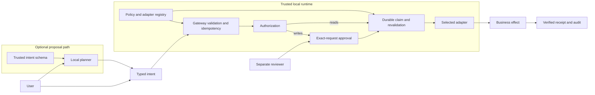
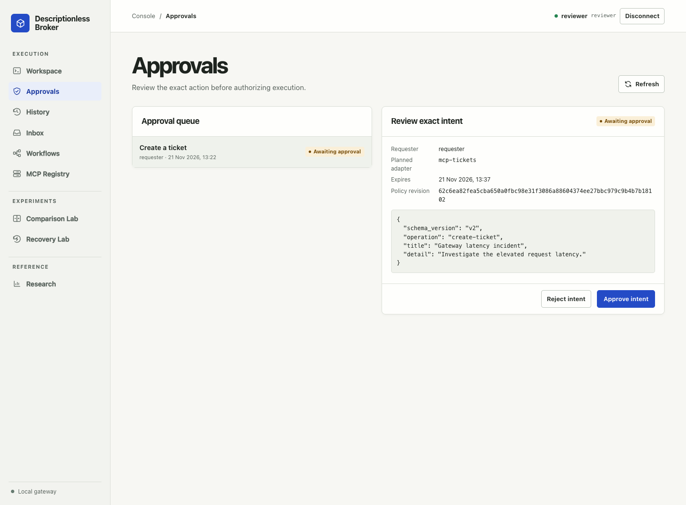
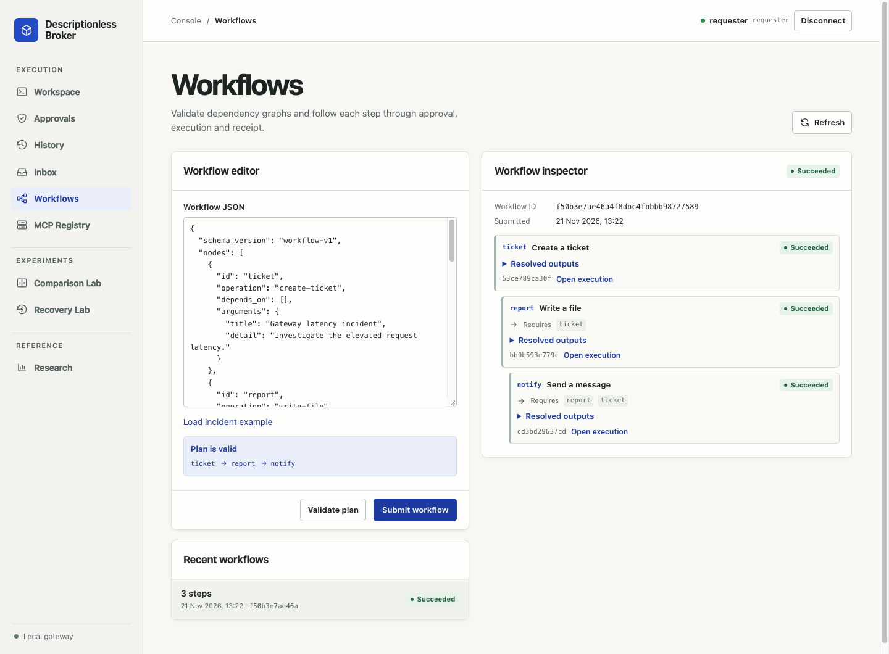

# Descriptionless Broker

Descriptionless Broker is a local gateway for executing approved requests. It creates tickets, writes workspace files, and delivers messages to a local inbox. Every execution records its outcome and what the gateway could verify about it.

When a model selects from tool descriptions, changing a description can change which tool it calls. Here, the optional model drafts a typed request using the user's input and a fixed schema. The gateway checks permissions and chooses the adapter. For writes, a separate reviewer approves the exact arguments before the worker can act.

[Run locally](#run-the-gateway) · [Verify](#verify) · [MCP and workflow walkthrough](docs/WORKBENCH.md)

## Execution boundary



Implementation metadata stays inside the trusted runtime. Lifecycle events record decisions throughout execution. A write approval binds the reviewer to an execution's canonical argument hash, policy revision and pinned routing snapshot. The worker rechecks authorization, reviewer eligibility, expiry and routing before claiming work. Workflow references resolve **before** each step is reviewed, so approval covers the actual ticket ID, file content or message.

Completion depends on the effect boundary:

- **Local SQLite:** the ticket or inbox change, checked receipt and success event commit together.
- **Filesystem:** create-only publication uses staged bytes, inode/digest checkpoints and directory synchronization. Cleanup retries preserve a committed success. Recovery requires matching publication evidence.
- **MCP:** a restricted loopback ticket service owns a separate database. Success requires a matching acknowledgment and readback. Lost or inconsistent evidence becomes `outcome_unknown`, with no automatic retry or local fallback.

An inbox receipt means a local database commit. A workflow can partially complete, retaining the effects of successful steps. Local `lookup-record` and `update-ticket` address gateway-owned tickets only. MCP tickets require the service's readback interface or direct inspection.

## Guarantees and evidence

| Guarantee | Implementation | Verification |
| --- | --- | --- |
| Registry metadata does not construct planner context | [Planner](gateway/planner.py), [routing identity](gateway/config.py) | [Context isolation tests](tests/test_gateway.py), [workflow proposal test](tests/test_expansion.py) |
| Exact review and pre-claim revalidation | [Approval and claim](gateway/engine.py) | [Snapshot, expiry, revocation and policy tests](tests/test_gateway.py) |
| Same requester and key replay one execution. Changed arguments conflict. | [SQLite uniqueness and transactions](gateway/store.py), [submission](gateway/engine.py) | [Concurrent duplicate tests](tests/test_gateway.py) |
| Local business changes and success receipts commit atomically | [SQL adapters](gateway/adapters.py), [execution](gateway/engine.py) | [Receipt rejection and process-kill tests](tests/test_gateway.py) |
| File recovery needs proof. Cleanup failure preserves success. | [Workspace](gateway/workspace.py), [recovery](gateway/engine.py) | [Cleanup regression tests](tests/test_gateway.py), [eight recovery cases](evidence/expansion-2026-11-21/recovery/report.json) |
| Ambiguous external effects are never automatically replayed | [MCP bridge](gateway/mcp_bridge.py) | [Lost acknowledgment, semantic disagreement and no-fallback tests](tests/test_expansion.py) |
| Bounded workflows review resolved arguments and skip failed dependents | [Compiler and scheduler](gateway/workflows.py) | [Workflow tests](tests/test_expansion.py), [five independently inspected workflows](evidence/expansion-2026-11-21/workflows/report.json) |

The recorded macOS runs passed **20/20 local incident sequences and 4/4 controls**, **5/5 MCP workflows**, **8/8 process recovery cases**, and **8/8 deterministic comparison cells**. The runs use fixed workloads and scripted approval. Recovery evidence covers process termination on the tested filesystem. [Gateway results](evidence/gateway-2026-11-21/README.md) · [Workbench results](evidence/expansion-2026-11-21/README.md)

The historical Qwen 2.5 3B comparison is **INVALID** under its predeclared gates. Across 20 tasks, broker utility was 85%, baseline utility 75%, correct invariance 85%, and baseline attack success 35% against a 40% gate. The 80-row offline research matrix and neutral metadata lab verify plumbing and observed effects. Live model resistance, exfiltration prevention and superiority over conventional architectures remain unproven. [Research provenance and limitations](docs/RESEARCH.md)

<details>
<summary>Console evidence for exact approval, workflow and recovery</summary>

The existing captures show review of exact arguments and a completed three-step incident workflow.




[MCP registry](evidence/expansion-2026-11-21/browser/mcp-registry.png) · [Recovered success](evidence/expansion-2026-11-21/browser/recovery-success.png) · [Uncertain outcome](evidence/expansion-2026-11-21/browser/recovery-unknown.png)

</details>

## Supported scope

One local owner, three demonstration roles, one scope and one worker on macOS or Linux. The host operator, policy, executable adapters, service credentials and runtime storage are trusted. Separate principal tokens do not establish separate human identities. A hostile process sharing the service account is outside this boundary.

Internet-facing deployment, arbitrary MCP tools, ticket federation, distributed exactly-once delivery, workflow compensation and multi-turn model security are outside scope. The [architecture and operations guide](docs/GATEWAY.md) covers retention, capacity, recovery and maintenance.

## Run the gateway

Use Python 3.12 and Node 22 on macOS or Linux. Keep operational state on a private local filesystem that supports hard links and directory synchronization.

```sh
python3.12 -m venv .venv
. .venv/bin/activate
python -m pip install -r requirements-lock.txt
python -m gateway init
python -m uvicorn gateway.api:app --host 127.0.0.1 --port 8000 --no-proxy-headers
```

Initialization prints three generated application credentials once. Keep them private. The requester and agent submit operations. The reviewer approves them and can inspect the scoped audit trail. The runtime defaults to `~/Library/Application Support/Descriptionless Broker/gateway` on macOS and `$XDG_STATE_HOME/descriptionless-broker/gateway` on Linux, using `~/.local/state` when `XDG_STATE_HOME` is unset. Configure another private local root with `GATEWAY_DATA_DIR`. See [.env.example](.env.example) for the other settings.

Start the console in a second terminal.

```sh
cd frontend
npm ci
npm run dev -- --hostname 127.0.0.1
```

Open [the local execution console](http://127.0.0.1:3000) and connect with the requester credential. Each tab keeps its token in memory. For a production build, run `npm run build` followed by `npm run start -- --hostname 127.0.0.1`. The console defaults to `http://127.0.0.1:8000`. To change the API origin, set `NEXT_PUBLIC_BROKER_API_URL` before starting development or building. If the console uses a different origin, allow it through `GATEWAY_FRONTEND_ORIGINS` on the backend.

For a first run, submit **Create a ticket** as requester, then connect as reviewer in a second tab and approve its exact arguments. Inspect the receipt in **History**. With default local routing, **Look up a record → Tickets** verifies the new ticket. The [workbench walkthrough](docs/WORKBENCH.md) sets up the independent MCP service and demonstrates ticket → report → notification with separate approval of each resolved step.

The typed path runs without a model or third-party credentials. For natural-language proposals, set `GATEWAY_OLLAMA_MODEL` to an installed local model before starting the API. The console displays the proposed fields for review before submission. If the provider is unavailable, the gateway returns an explicit error.

## Verify

```sh
python -m pip check
python -m pytest -q --tb=short
python -m evals.research_provenance verify
python -m evals.gateway_evaluate --out .runtime/gateway-evaluation.json
python -m evals.run --mode offline --out .runtime/research-evaluation.json
# Use a new output directory for each expansion run.
python -m evals.expansion_evaluate --out .runtime/expansion-evaluation
cd frontend
npm run lint
npm run build
npm exec -- tsc --noEmit
```

CI runs the backend checks on Linux and macOS, and the frontend checks on Linux. Each backend job uploads its evaluation reports. [CI workflow](.github/workflows/ci.yml) · [GitHub Actions](https://github.com/s2107aarav/descriptionless-broker/actions/workflows/ci.yml)
